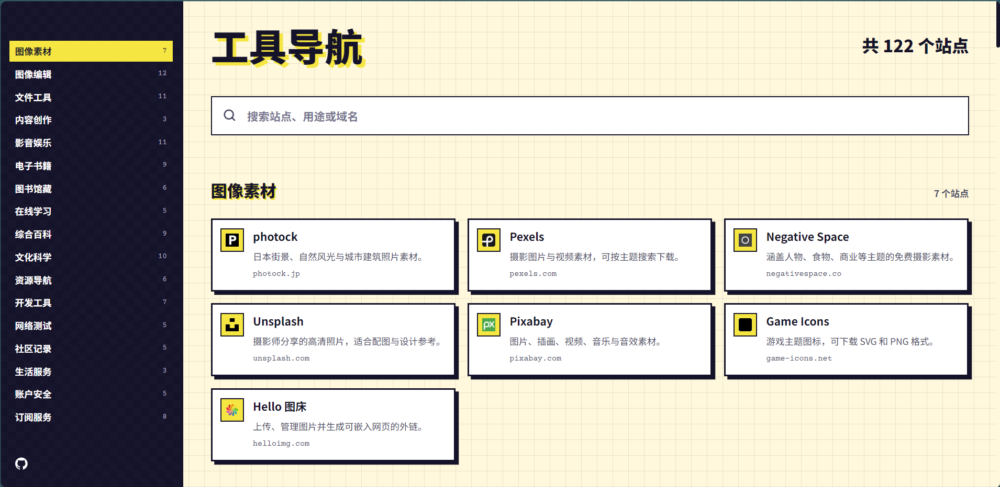

# Toolbox

  

  <strong>导航 · 资源 · 工具</strong> 
  按用途整理的资源导航与在线工具

  
  
  

## 项目简介

Toolbox 是一个静态工具箱，包含资源导航和 23 个可直接使用的在线计算工具。资源导航按用途整理为十六个分类，同一分类内按相近用途连续排列。

可按分类浏览或搜索站点，点击卡片会在新标签页打开目标网站。

## 功能概览

- 在线工具：23 个计算器分为收入与定价、增长与留存、成本与规划三类，支持搜索、货币标识切换、计算场景切换和订阅开支汇总。
- 资源导航：收录站点按用途分为十六个分类，同一分类内按相近用途连续排列。
- 站点搜索：按站点名称、描述、域名或分类名称实时筛选，并显示匹配数量。
- 目录联动：资源导航和在线工具页均支持点击目录跳转到对应分类，滚动页面时目录自动高亮当前分类。
- 移动适配：窄屏下分类目录变为横向排列，站点卡片切换为单列显示。

## 界面预览

  

## 使用方式

访问 <https://toolbox.krelinnbios.com>，可搜索站点或按分类浏览。在线计算器位于 [工具页面](https://toolbox.krelinnbios.com/tools.html)，支持部分计算场景切换；货币切换只改变金额标识，不进行汇率换算。

本地预览需通过 HTTP 服务打开 `index.html` 或 `tools.html`，无需安装 npm 依赖或构建。计算测试需 Node.js 24 或更高版本，运行 `node --test test/calculations.test.mjs`。

## 隐私与数据

- 本地处理：搜索、筛选和排序均在浏览器本地完成，输入的关键词不会发送到任何服务。
- 工具计算：所有计算在浏览器本地完成，数字和订阅名称不会上传或持久保存；刷新页面后恢复默认输入。在线工具页面不加载访问统计脚本。
- 访问统计：站点通过 VibeCafé 统计脚本上报页面浏览事件，内容仅包含随机访客标识和事件类型，不包含搜索词或浏览内容，也不使用 Cookie；浏览器启用“请勿跟踪”或“全局隐私控制”时不会上报。
- 跳转访问：站点卡片直接指向目标网站，不经过中间跳转页面；目标网站的数据处理由其自身隐私政策说明。
- 第三方资源：站点图标通过 Google 图标服务加载，会向该服务发送目标站点域名；页面字体通过 Google Fonts 加载。

## 内容边界

- 站点名称与描述由本项目整理，仅说明主要用途；与收录站点及其运营方无隶属关系，收录不代表推荐。
- 外部站点的可用性和服务质量由各站点运营方负责。
- 计算结果基于输入和简化假设，仅用于估算与规划，不构成财务、税务、法律或投资建议。
- “订阅服务”分类中的部分链接包含邀请码或推广参数，使用前请自行确认服务内容、价格和适用条款。

## 许可协议

本项目代码和项目自有文档依据 [MIT License](./LICENSE) 发布，允许使用、修改、分发和商业使用，但须保留许可证与版权声明。

收录的第三方站点、名称、图标、服务和内容不因被本项目链接而自动纳入 MIT License，各站点适用其自身条款和权利声明。

## 反馈与贡献

问题、站点建议和失效链接请提交至 [Issues](https://github.com/KrelinnBios/Toolbox/issues)。
