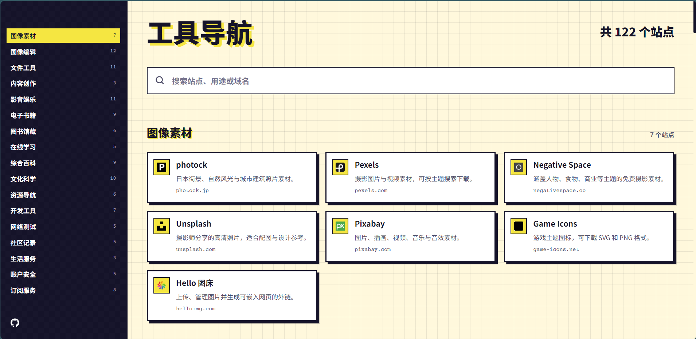

# Toolbox

  

  
  
  

## 项目简介

Toolbox 是一个纯静态的在线工具导航页面，按分类整理常用在线工具与资源。

## 界面预览

  

## 使用方式

- 在线访问：<https://toolbox.krelinnbios.com>，无需注册或安装。
- 在搜索框输入站点名称、用途或域名筛选结果。
- 点击左侧分类（移动端为横向分类栏）跳转到对应分类。
- 点击站点卡片直接跳转到目标网站。

## 隐私与数据

- Toolbox 是纯静态网页，不收集用户数据，也不要求注册账号。
- 所有站点链接直接跳转到目标网站，不经过中间服务器。
- 搜索和分类定位均在浏览器本地完成，输入内容不会发送到任何服务。
- 站点图标通过 Google 图标服务加载，图标请求会向该服务发送目标域名；加载失败时显示名称首字。

## 内容边界

- 本项目为工具导航站，收录的站点与作者无隶属关系。
- 站点可用性和服务质量由各站点运营方负责，本项目仅提供导航链接。
- “账号与订阅”分类中的部分链接可能包含注册或推广参数，使用前请自行确认服务内容、价格和适用条款。
- 使用第三方站点时，请遵守对应站点的服务条款和使用规范。

## 许可协议

本项目代码和项目自有文档依据 [MIT License](./LICENSE) 发布，允许使用、修改、分发和商业使用，但须保留许可证与版权声明。

收录的第三方站点、名称、图标、服务和内容不因被本项目链接而自动纳入 MIT License，各站点适用其自身条款和权利声明。

## 反馈与贡献

欢迎通过 [GitHub Issue](https://github.com/KrelinnBios/Toolbox/issues) 提交问题、建议新增站点或改进导航体验。